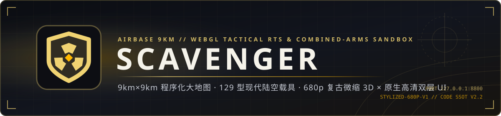
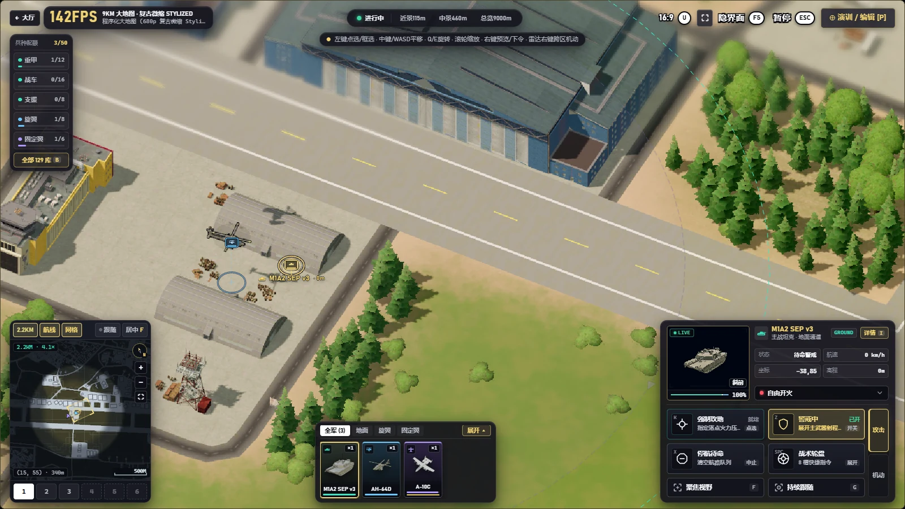
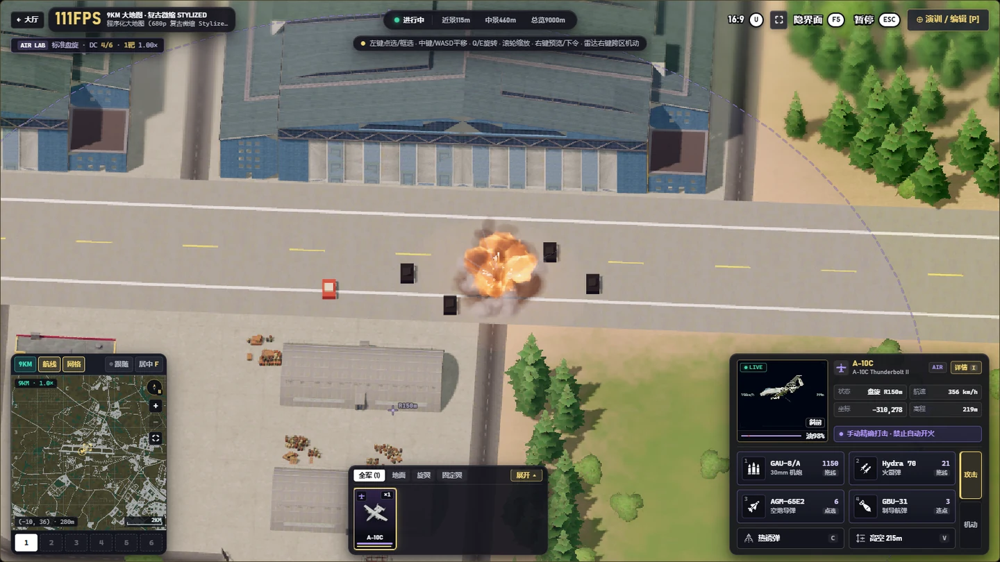
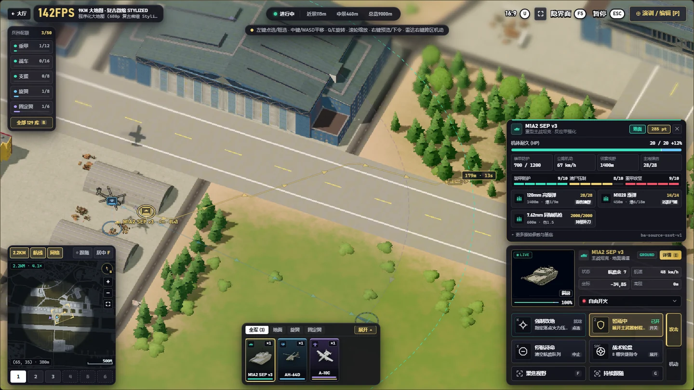
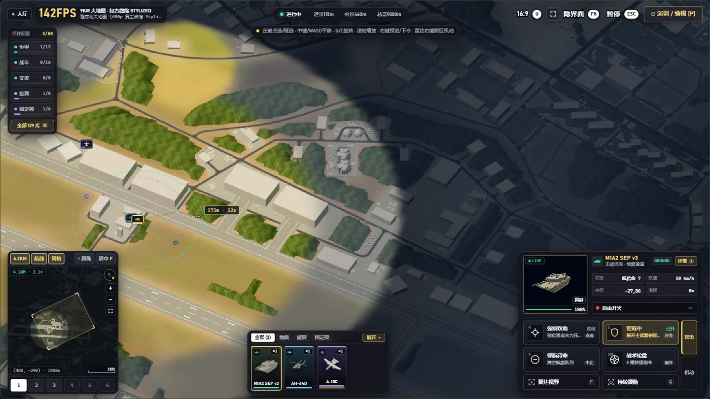
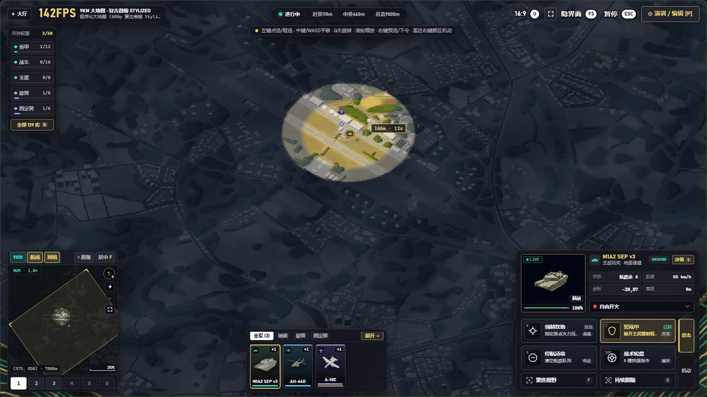
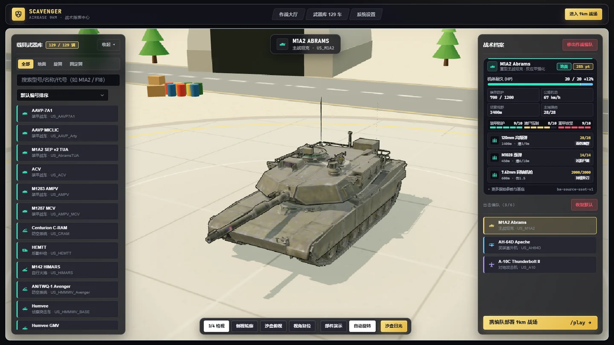
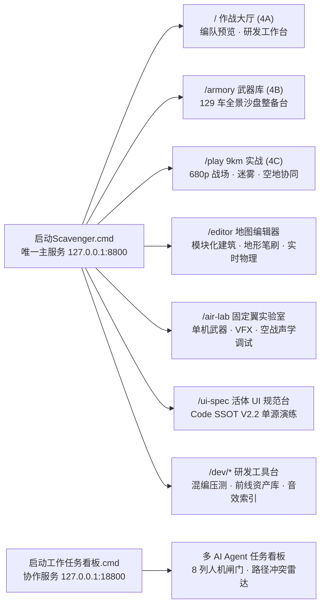

<div align="center">



<br />


<p>
  <strong>基于 Three.js 构建的网页端 9km × 9km 现代陆空协同战术 RTS / 沙盘研发主干</strong><br />
  统一单端口 <code>127.0.0.1:8800</code> · 零前端打包构建 · 680p 复古微缩 3D × 原生 DPR 高清双层 UI
</p>

[实机画廊](#-9km-实战主场景实机画廊) · [新版武器库](#-4b-129-车全景沙盘武器库) · [项目特色](#-项目核心特色) · [系统架构](#-系统架构与统一路由) · [项目结构](#-项目结构) · [快速启动](#-快速启动与校验) · [文档归档](#-文档导航与历史归档)

</div>

---

## 🎯 项目概览

**Scavenger** 是一款面向桌面端浏览器（Chrome / Edge）的现代陆空协同战术即时战略（RTS / RTT）三维游戏与全栈工程实验项目。项目以 **9km × 9km Airbase 程序化大地图** 为统一主战场，集成 **129 型现代陆/旋翼/固定翼载具流式体系**、双通道战争迷雾、写实爆炸 V3.0、物理声学传播总线与多 AI Agent 协同研发工具链，全部业务页面与开发工具统一收口至唯一正式端口 **`http://127.0.0.1:8800/`**。

<div align="center">
  
  <sub>▲ <b>9km 实战主场景（<code>127.0.0.1:8800/play</code>）</b>：680p 复古微缩 Stylized 渲染基线、Airbase 机场建筑与立体林区、全战竖长条透明底兵牌坞、左下 1:1 战术雷达、右下 Live PiP 载具实况窗与翻页命令栏。</sub>
</div>

---

## 🖼️ 9km 实战主场景实机画廊

以下全部实机画面直接采集自 **`http://127.0.0.1:8800/play`** 最新正式主干：

<table>
  <tr>
    <td width="50%" valign="top">
      
      <br />
      <strong>💥 固定翼低空突击与写实爆炸 V3.0</strong><br />
      <sub>32 架固定翼按 5 大原型族构建统一气动底座（工况燃油 / Bingo 返航 / 热诱弹脉冲），搭配 680p 阈值 HDR Bloom、8×8 体积云写实爆炸 V3.0（主 <code>vfxRoot</code> ≤ 6 DrawCall）与多普勒 3D 空间声学总线。</sub>
    </td>
    <td width="50%" valign="top">
      
      <br />
      <strong>🧭 RTS 精密指挥与双层原生高清标绘</strong><br />
      <sub>3D 场景锁定 680p 复古微缩质感，2D 航线/射程标绘、8 槽战术轮盘、<code>I</code> 键单位详情参数卡与全战兵牌独立运行于原生 DPR 高清层；右下 30FPS 离屏 Live PiP 零额外 WebGLContext 实时跟拍选中载具。</sub>
    </td>
  </tr>
  <tr>
    <td width="50%" valign="top">
      
      <br />
      <strong>🌫️ 双通道战争迷雾与 144Hz 战术雷达</strong><br />
      <sub>内置 <code>fog-of-war-v1</code> 10Hz 双通道迷雾引擎（含纯建筑 OBB 静态视野遮挡、电战热区与失联幽灵标），联动左下 <code>1024×1024</code> 真实地貌战术小地图（<code>9KM ↔ 1KM</code> 无级滚轮缩放、视野同步框与右键跨区下令）。</sub>
    </td>
    <td width="50%" valign="top">
      
      <br />
      <strong>🗺️ 9km 宏观视距与动态战术沙盘边框</strong><br />
      <sub>四级嵌套 CDLOD 地形 + 12 层生态混合 + <code>.scvmap</code> HTTP Range 流式分块加载；拉高镜头无缝过渡至实心集群林冠与外围 3D 实体地层剖面金属边框 + 深烟炭抗锯齿等高线 / MGRS 坐标网。</sub>
    </td>
  </tr>
</table>

---

## 🛡️ 4B 129 车全景沙盘武器库

原 V5 独立单车展示台已正式移除，全面升级并收口至主服务 **`http://127.0.0.1:8800/armory`**（支持 `?unit=<slug>` 深链与固定翼直跳 `/air-lab`）：

<div align="center">
  
  <sub>▲ <b>新版 4B 129 车全景沙盘武器库（<code>127.0.0.1:8800/armory</code>）</b>：全幅 680p Airbase 停机坪微缩日光沙盘展台、<code>miniature_sand</code> 材质 + 1.15px 平滑法线像素描边、37 车机械部件实时演示、战术档案参数卡与 6 槽出击编队直通 <code>/play</code>。</sub>
</div>

---

## ✨ 项目核心特色

| 维度 | 核心亮点 | 代码单源 / 规范文档 |
| --- | --- | --- |
| **🎨 680p 双层风格化渲染** | 锁定 `stylized-680p-v1`（`16:9 = 1208×680` / `21:9 = 1588×680` Hor+），结合 `HalfFloat MSAA 4×` HDR Bloom、微缩移轴景深与暖调胶片滤镜；HUD / 战术标绘 / 名牌保持原生 DPR 独立高清层。 | [渲染基线.mjs](src/程序化地图/渲染基线.mjs) · [渲染基线规范](docs/渲染风格与分辨率基线规范.md) |
| **🌍 9km 程序化流式大地图** | 四级 CDLOD 地形、`2m` 主高度场 + 81 处立体双层/桥梁补丁、Web Worker 异步解码高度纹理、`.scvmap` HTTP 206 Range 并发合并读取与远近景同锚点无闪烁交接。 | [src/程序化地图/](src/程序化地图/README.md) · [程序化地图计划](docs/地图与载具/程序化大地图重建与分级平滑过渡-实施计划.md) |
| **🚜 129 车与固定翼底座** | 全库 129 型现代陆空载具压缩为 `72.58 MiB` 分层 `.scvveh` 归档 + `36.8 KiB` 二进制索引；32 架固定翼按 5 大原型族共享气动、油门/加力、Bingo 燃油与精确打击底座；战斗数值统一遵循 `ba-source-ssot-v1`。 | [src/程序化载具/](src/程序化载具/README.md) · [数值基底规范](docs/地图与载具/数值基底与全局倍率规范.md) |
| **🔊 物理声学与写实爆炸** | 通用战场物理声学传播总线（近/中/远三档分桶、对数声速延迟、重爆超压背景音闪避、固定翼多普勒与前后半球指向性）+ 对标《Defilade》的写实爆炸 V3.0。 | [载具空间音效.mjs](src/程序化地图/载具空间音效.mjs) · [写实爆炸特效.mjs](src/程序化地图/写实爆炸特效.mjs) |
| **🧩 Code SSOT V2.2 治理** | 「A3 烟炭双金 × B2 微描边 × C4 外柔内锐」唯一设计令牌、负空间军事剪影与交互控件源，搭配 `/ui-spec` 活体规范台与 `检查项目结构.py` 全仓防漂移门禁。 | [src/界面规范/](src/界面规范/README.md) · [全局UI-UX规范](docs/全局UI-UX规范.md) |
| **🤖 多 AI Agent 协作基建** | 独立 `18800` 本地/局域网多 Agent 8 列工作项看板（SQLite WAL + SSE + 路径冲突雷达）、项目级 Agent Skills（`workboard-item-*`、`daily-dev-log`）与每日开发可视化看板。 | [scripts/工作项看板/](scripts/工作项看板/README.md) · [每日开发看板](reports/开发日志/每日开发看板.html) |

---

## 🏗️ 系统架构与统一路由

全项目所有游戏视图与研发调试工具均收敛至单一正式端口 **`127.0.0.1:8800`**，研发任务协作则独立运行于 **`127.0.0.1:18800`**：



---

## 📂 项目结构

```text
Scavenger/
├─ 启动Scavenger.cmd                 # 全项目唯一正式主服务一键入口 (127.0.0.1:8800)
├─ 启动工作任务看板.cmd               # 独立多 AI Agent 协作看板一键入口 (127.0.0.1:18800)
├─ AGENTS.md                         # 项目协作规则、跨会话保护与质量门禁总纲
├─ src/                              # 正式运行时与前端核心源码（原生 ES Modules，零构建）
│  ├─ 主入口/                        # 4A 作战大厅 (/)、4B 129 车全景沙盘武器库 (/armory)、系统设置
│  ├─ 程序化地图/                    # 4C 9km 大地图引擎、渲染基线、战争迷雾、固定翼底座、写实爆炸与空间声学
│  ├─ 程序化载具/                    # 129 车 .scvveh 流式加载器、风格化材质、组件级 InstancedMesh 与混编压测场
│  ├─ 交互系统/                      # RTS/RTT 键鼠仲裁、编组队列、8 槽战术轮盘与原生 DPR 高清 2D 标绘层
│  ├─ 界面规范/                      # Code SSOT V2.2 令牌、共享控件、品牌/军事剪影单源与 /ui-spec 活体台
│  ├─ 工作项看板/                    # 18800 多 Agent 协作看板暗色前端
│  └─ 资料库 / 音效索引 / 战术演训 / 原作群尸 / 载具靶场 / ...   # 研发资产工具台与历史对照原型
├─ scripts/                          # Python 主服务、双浏览器验收、资产离线编译流水线与结构门禁
│  ├─ 启动主服务.py                  # 127.0.0.1:8800 统一路由与 HTTP 206 Range / Gzip 分发服务
│  ├─ 验证主服务全链路.py            # Chrome / Edge 双浏览器全路由端到端验收
│  ├─ 检查项目结构.py / 检查报告.py  # 全仓目录边界、链接有效性、UI/渲染/数值三大 SSOT 自动门禁
│  ├─ 程序化地图/ & 程序化载具/       # 地图 .scvmap 与 129 车 .scvveh / 兵牌离线编译及性能基线脚本
│  ├─ 工作项看板/ & 维护清理/        # 18800 看板后端与安全版本退役/缓存定时维护工具
│  └─ 断箭/ / 资源库/ / 资源优化/    # 资产解析、统一库查询与压缩归档工具
├─ docs/                             # 正式策划、三大核心规范、实施计划、界面预研沙盒与 README 展示图
├─ reports/                          # 离线自包含 HTML 验证报告、性能基准与每日开发看板
├─ research/                         # 来源台账、观察记录与核验元数据（不作为运行时依赖）
├─ public/assets/                    # 已单独确认入库的共享静态运行时资产（如爆炸 8×8 体积云图集）
├─ .agents/skills/                   # 项目级 AI 协作技能（workboard-item-*、daily-dev-log）
└─ local-data/  (Git 忽略)           # 本机第三方工具、大体积模型/音效/地图包、原始快照与运行缓存
```

完整源码与工具索引见 [docs/apps-code-map.md](docs/apps-code-map.md)。

---

## 🚀 快速启动与校验

### 1. 一键启动主服务（推荐）
双击根目录 [启动Scavenger.cmd](启动Scavenger.cmd)，或在终端运行：

```powershell
# 启动唯一正式主服务并自动打开浏览器（http://127.0.0.1:8800/）
python -X utf8 -B scripts/启动主服务.py --open

# 可选：直达指定路由（play / armory / editor / air-lab / ui-spec / settings）
python -X utf8 -B scripts/启动主服务.py play --open

# 启动独立多 AI Agent 本地工作项看板（http://127.0.0.1:18800/）
python -X utf8 -B scripts/工作项看板/启动看板服务.py --open
```

> **运行前提说明**：项目大体积模型、`.scvmap` 地图包、`.scvveh` 载具归档、音效与 Three.js 本地依赖均保存在 `.gitignore` 忽略的 `local-data/` 目录中。**仅克隆 Git 源码不包含这些大体积本地资产**，新机器接入与资源包导入方式请先阅读 [多人协作方案](docs/多人协作方案.md)（含 [离线可视化页](reports/多人协作/多人协作方案.html)）。

### 2. 日常结构门禁与验收命令

```powershell
# 全仓目录边界、相对链接与 UI/渲染/数值三大 SSOT 防漂移门禁
python -X utf8 -B scripts/检查项目结构.py

# 离线可视化报告完整性检查
python -X utf8 -B scripts/检查报告.py

# Chrome / Edge 双浏览器 8800 主服务全链路验收（含 4A / 4B / 4C / 编辑器 / UI 规范台）
python -X utf8 -B scripts/验证主服务全链路.py

# 本地存储轻量化只读防堆积体检
python -X utf8 -B scripts/维护清理/清理工具.py audit --no-write
```

---

## 📚 文档导航与历史归档

| 主题 | 核心入口 |
| --- | --- |
| **策划与开发总览** | [文档阅读导航](docs/README.md) · [大地图肃清-正式策划书](docs/大地图肃清-正式策划书.md) · [开发目标与人工验收](docs/大地图肃清-开发目标与人工验收.md) · [项目简报 V003](reports/大地图肃清/大地图肃清项目介绍-V003-01a1e39c/大地图肃清-项目介绍.html) |
| **三大工程规范（SSOT）** | [单端口整合与正式开发规范](docs/单端口整合与正式开发规范-实施计划.md) · [全局UI-UX规范](docs/全局UI-UX规范.md) · [渲染风格与分辨率基线规范](docs/渲染风格与分辨率基线规范.md) · [数值基底与全局倍率规范](docs/地图与载具/数值基底与全局倍率规范.md) |
| **协作、维护与性能** | [项目结构与开发约定](docs/项目结构与开发约定.md) · [网页端性能优化实施计划](docs/网页端性能优化-实施计划.md) · [版本退役与缓存清理规则](docs/版本退役与缓存清理规则.md) · [项目轻量化与定时清理规范](docs/项目轻量化与定时清理规范.md) · [脚本维护说明](scripts/脚本维护说明.md) · [报告维护说明](reports/报告维护说明.md) |

<details>
<summary>🗂️ 展开历史阶段、早期试验端口（8767–8814）与资料提取归档说明</summary>

- 原根 `README.md` 中的早期试验端口（`8767`/`8768`/`8769`/`8780`/`8781`/`8784`/`8794`/`8797`/`8798`/`8809–8814`）、历史批次验收边界、十三款丧尸分享包与 `BA-26273833-001`–`009` 音频/模型提取记录已无损归档至 **[docs/历史里程碑与原型归档.md](docs/历史里程碑与原型归档.md)**。
- 资产与性能专题报告仍保留在 [reports/](reports/报告维护说明.md) 目录中，包括 [程序化大地图验证报告](reports/程序化地图/程序化大地图重建与平滑过渡验证报告-V001.md)、[程序化载具验收报告](reports/程序化载具/程序化载具优化与视觉验收报告-V001.md)、[RESTAND 玩法交互研究](reports/RESTAND玩法交互研究.html) 与 [每日开发看板](reports/开发日志/每日开发看板.html)。

</details>
