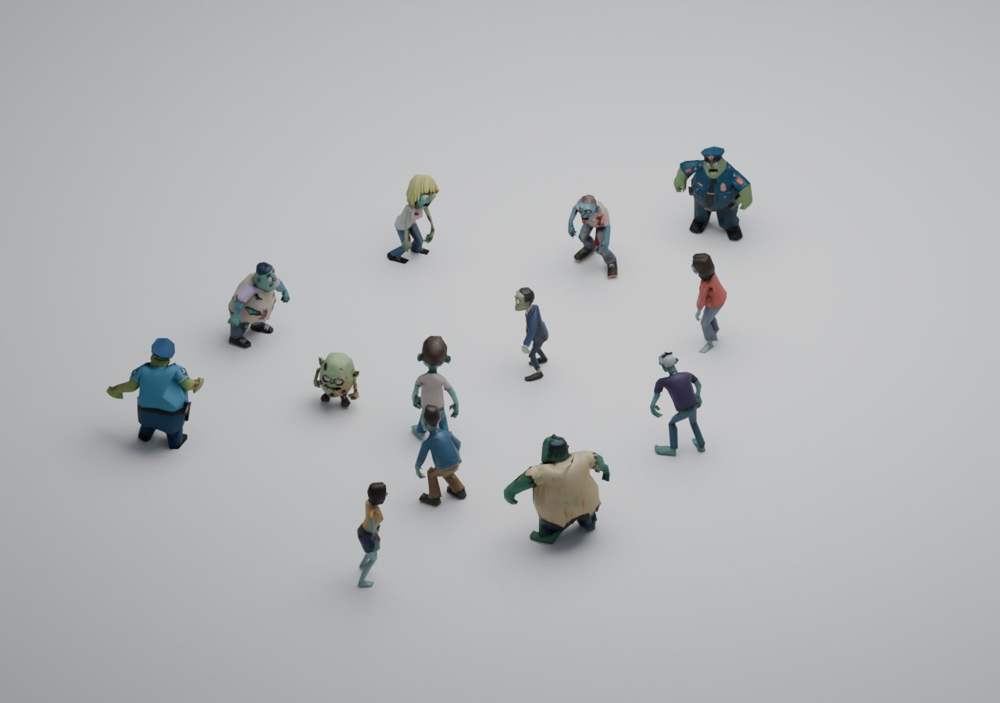
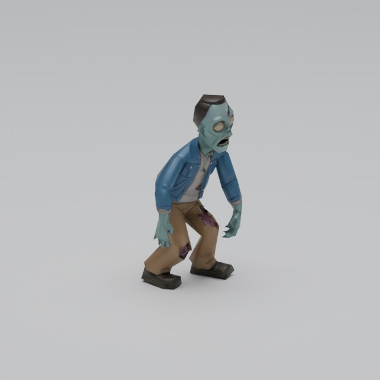
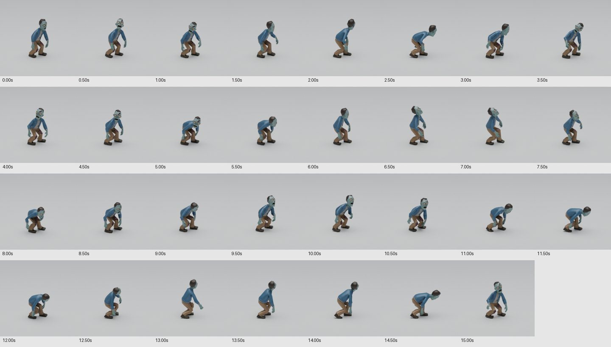
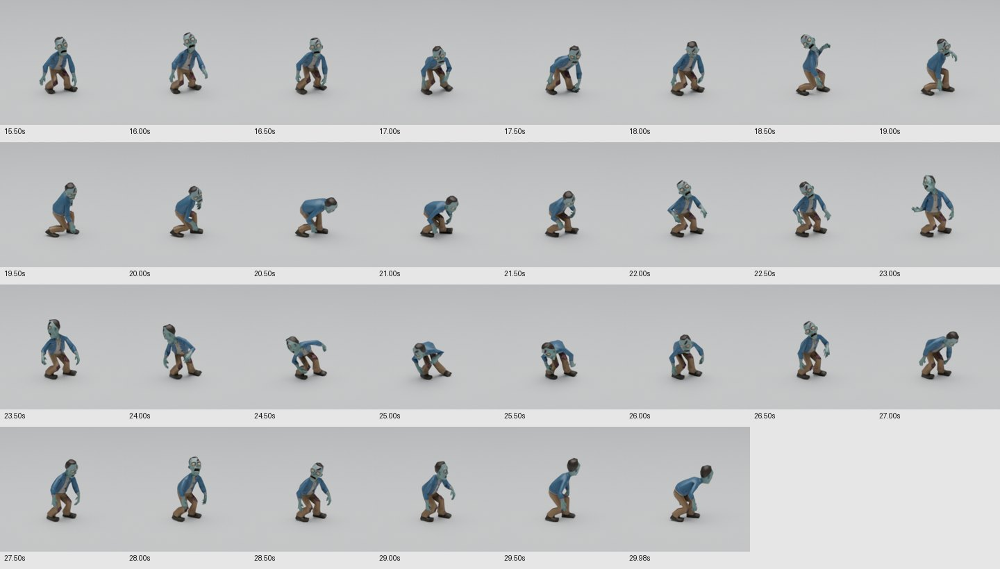
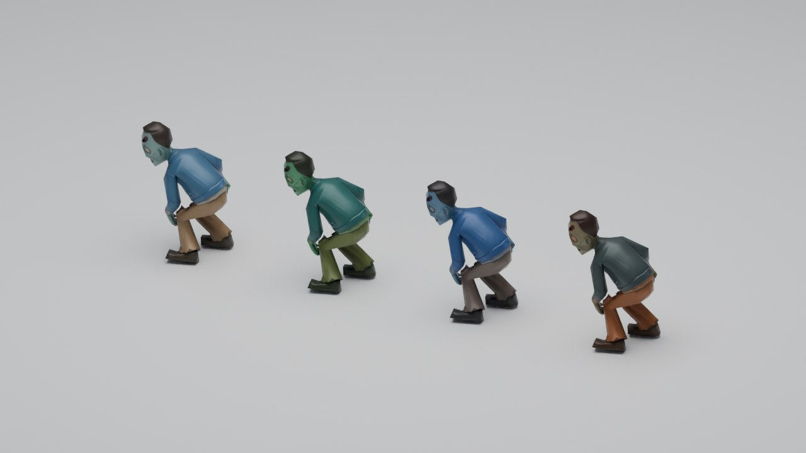
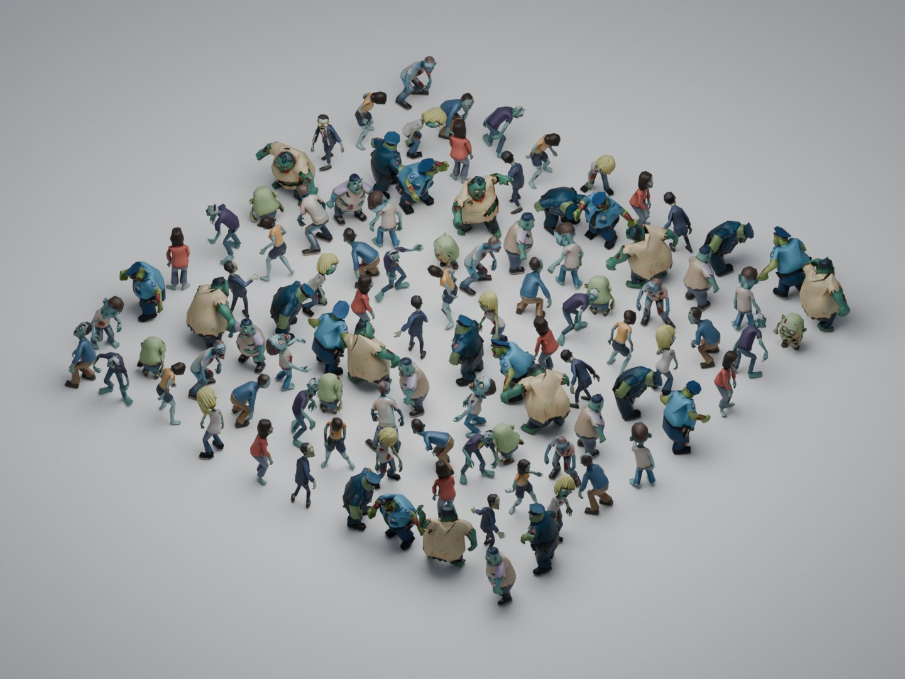

# 低面数丧尸模型测试报告

测试日期：2026-11-03。批次：`ZOM-261103-001`，采用本地批次的`完整测试修订1`。工具：Blender 5.2.3 LTS，独立后台进程与实际渲染图检查。

本会话的原件、当前及历史工程已按摘要登记于[资源清单](../../research/丧尸模型/资源清单.json)，统一入口见[资料归档说明](../../research/丧尸模型/资料归档说明.md)。后续500只同屏讨论见[丧尸群体设计与性能研究](../../docs/丧尸群体设计与性能研究.md)，其中推算和建议不属于本报告的实测结论。

## 结论

**适合作为俯视丧尸群的美术候选。面数低、体型有变化、能够整体换色，单只角色的骨架拆分测试通过。用于正式游戏前，还需整理动作和运行资源，并在Three.js中测试动态群体性能。**

| 需求 | 实测结果 | 判断 |
| --- | --- | --- |
| 低面数 | 13只，每只796或800三角形，合计10392三角形 | 符合当前低面数方向 |
| 群体变化 | 男女、胖瘦、警察及大头角色，服装与轮廓有区别 | 适合组成卡通丧尸群；最终风格仍由工程师确认 |
| 独立使用 | 原包共用287骨骼；编号0精简为23骨骼，逐帧顶点比较通过 | 拆分方法可行；其余12只尚未逐个完成拆分动画验收 |
| 材质换色 | 原贴图乘颜色即可形成变化 | 整体染色通过；皮肤和衣服会同时变化，分区换色需遮罩 |
| 游戏动作 | 约29.98秒的单个动作，示例主要原地踉跄、弯腰、抬头、转向 | 不能直接当作已整理好的待机、行走、攻击和死亡动作包 |
| 网页群体性能 | 100只静态姿态预览约79936三角形 | 只验证视觉密度和重复感，动态性能待测 |

## 输入与来源

- 输入：工程师提供的`super_low-poly_stylized_zombies_animated.glb`，只读处理。
- 文件大小：36182136字节，约34.51 MiB。
- SHA-256：`19523156c1b229d2720e72eb6a9400488f6a793eb14a62fd49a09dec38ace7ea`。测试前后相同。
- 文件嵌入来源：[Super Low-poly Stylized Zombies (animated)](https://sketchfab.com/3d-models/super-low-poly-stylized-zombies-animated-6c112bed707b4444864b606299f8b85a)。
- 文件嵌入作者：[Jungle Jim](https://sketchfab.com/jungle_jim)，许可声明：[CC BY 4.0](https://creativecommons.org/licenses/by/4.0/)。本报告渲染图基于该模型，增加摄影棚、角色拆分、整体染色及群体排列，保留作者与来源。
- 可追溯数据：[Blender测试记录](../../research/丧尸模型/Blender测试记录.json)。本轮来源信息取自实际GLB，不以模型标题代替文件检查。

## 几何、绑定与材质

输入包含13个蒙皮网格、1个skin、1个动画和13个材质。每只一个网格、一个材质。所有角色共享一套287骨骼的绑定；多数骨骼仅属于某个角色，不能把整套骨架作为每只丧尸的运行开销直接复制。

| 编号 | 三角形 | 实际加权骨数 | 加权骨及必要祖先数 |
| --- | ---: | ---: | ---: |
| 0 | 800 | 20 | 23 |
| 1 | 800 | 20 | 23 |
| 2 | 800 | 20 | 23 |
| 3 | 796 | 19 | 23 |
| 4 | 800 | 20 | 23 |
| 5 | 800 | 20 | 23 |
| 6 | 800 | 20 | 23 |
| 7 | 800 | 20 | 23 |
| 8 | 796 | 20 | 23 |
| 9 | 800 | 20 | 23 |
| 10 | 800 | 20 | 23 |
| 11 | 800 | 18 | 21 |
| 12 | 800 | 20 | 23 |

贴图共26张，均为512×512，13组基础色与法线贴图。按RGBA8、无mipmap估算，全部图像像素为26 MiB；这是纹理格式的粗略预算，不是实测显存。源材质均标记双面，后续可按实际可见效果评估单面渲染。

13只各带一个`target_0`形态键，其所有顶点与Basis的最大位置差均为0。测试副本删除空形态键，原文件保持原样。Blender导入产生的`glTF_not_exported`辅助球体已隐藏，不计入13只角色或10392三角形。

## 独立角色与动画验证

### 拆分方法与证据

编号0只保留实际加权骨及祖先，共23骨骼；移除其他角色的骨骼和曲线，保留当前角色的原始动作。先在相同世界坐标下比较原始与拆分网格，再整体移至展示原点，避免把位置变化误判为蒙皮错误。

- 在0至719帧逐帧比较，并加入719.5999756帧的末端，共721个时刻；每个时刻比较全部659顶点。
- 最大顶点位置误差约`2.67×10⁻⁷`米，低于测试容差`10⁻⁴`米。
- 保存后用新的Blender进程重开，在首尾及中间共8个时刻再次比较；扣除展示平移后最大误差约`2.42×10⁻⁶`米，26张纹理均已嵌入，4个场景和23骨骼保留。
- 上述数值按导入坐标的米制解释；证明本次拆分与保存保真，不代表所有角色、所有导出格式或游戏动作均已验收。

### 现有动作能做什么

文件只有一个名为`CameraAction`的动画，但实际包含丧尸骨骼动画，也包含相机节点及空形态键轨道。不能凭名称判断为相机专用动画。

按24 FPS解释，该动作长约29.98秒。编号0的视觉序列显示原地踉跄、身体起伏、弯腰、抬头和明显转向；髋部世界坐标在X、Y、Z方向的变化范围约为0.265、0.352、0.143米，没有形成沿一个方向持续前进的轨迹。**当前更适合用作氛围动作候选，移动循环仍需专门整理。**

原段首尾直接比较时，顶点平均差约0.319米、最大差约0.732米，说明整段直接循环存在明显跳变。此结论不表示片段内部找不到可用短循环。

视觉检查采用覆盖首尾的61张图，间隔0.5秒，末端另取一张；不是人工实时看完整段，也没有逐个检查全部13只的整段动画。攻击、受击和死亡动作尚未验证，不列为现成能力。

## 换色与群体效果

### 整体换色

从左至右为原色、绿色、蓝色和暖色乘色测试。保留原贴图明暗，变化清楚，但皮肤、衣服和裤子共同变色。若只想换衣服、保持肤色稳定，建议增加皮肤与服装遮罩；也可在后续美术整理时改用调色板贴图。此处没有完成分区换色或统一图集。

### 100只静态预览

使用13种角色重复排列，分别从原动画的不同时间取姿态，增加朝向和位置扰动。此图中胖瘦轮廓仍然明显，服装提供第二层差异；夸张卡通风格较强。远景下五官和破损细节贡献有限，适合优先保留轮廓与颜色变化。

这100只均为烘焙姿态后的静态网格，共约79936三角形，无实时骨骼、寻路、碰撞和攻击逻辑。没有测量Three.js中的帧率、Draw Call、GPU耗时或动态群体上限。

## Blender工程使用

本地工程保存在`local-data/丧尸模型/测试/ZOM-261103-001/完整测试修订1/丧尸模型测试.blend`。目录同时保存检查结果、独立重开回执、日志及脚本快照。初版与探查资料保留在同批次，当前采用修订1。

打开工程后默认进入`02独立角色动画`，按空格播放。通过右上方场景下拉框切换：

| 场景 | 内容 |
| --- | --- |
| `01原始整组动画` | 13只原始绑定与动画，便于检查整体 |
| `02独立角色动画` | 编号0的23骨骼测试副本，可独立放置与播放 |
| `03整体彩色测试静态` | 原色加三种整体换色，静态展示 |
| `04百只群体静态预览` | 100只静态姿态，检查轮廓、密度与重复感 |

首次测试工程包含原始动画、摄影棚和展示副本，约82.43 MiB。归档期间该工程被外部重新保存，当前保存版约82.76 MiB，已单独重开核对8个时刻、23骨骼、4场景和26张嵌入贴图；原始核验版由同目录`丧尸模型测试.blend1`保留，摘要与原回读凭证一致。原有721时刻比较与展示图对应首次测试，旧记录保持原样；当前文件身份及新核验入口见资源清单。

上述工程不是体积优化后的运行包。本轮未输出正式GLB、未入库、未接入游戏。

## 接入前需要准备的内容

1. 先选定2至3种主轮廓，逐只拆分并验证动作；暂时无须全部13种都进入首轮原型。
2. 整理方向稳定、脚底接触合理的短循环，分出待机、行走、攻击、受击、死亡状态，检查切换与循环首尾。
3. 确认只需整体染色还是需要分区换色，再做贴图合并、调色板或遮罩；精简相机、空形态键和无用轨道。
4. 在实际Three.js镜头下按100、300、500只递增测试，分别记录骨骼更新、绘制、阴影和逻辑开销，再决定动画分级或其他优化方案。这些数量是建议测试档位，不是已证明的承载量。

脚本入口、参数和复测方式见[脚本维护说明](../../scripts/脚本维护说明.md)。本次保留候选资格，最终美术选择和动态性能由后续验收确定。
