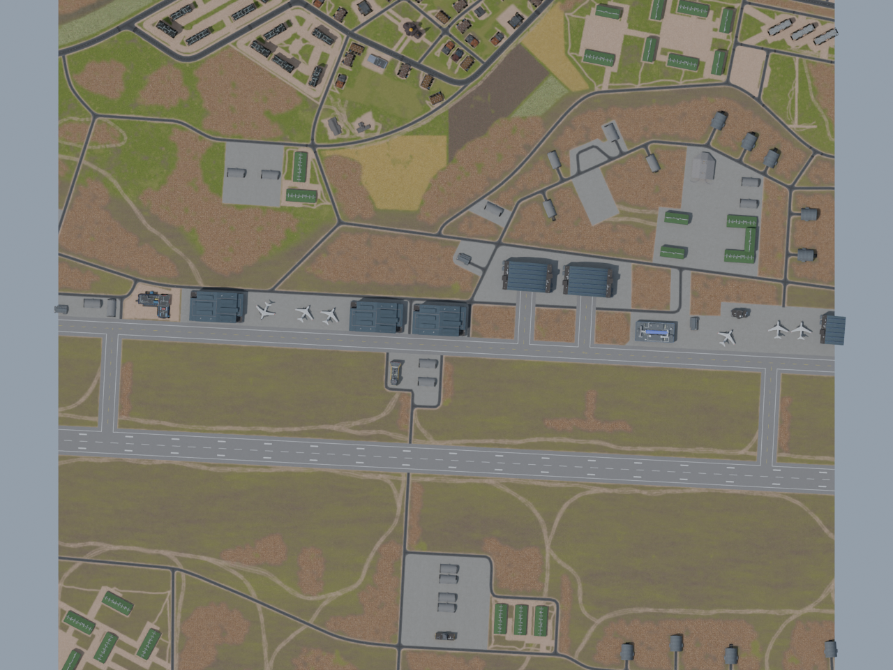
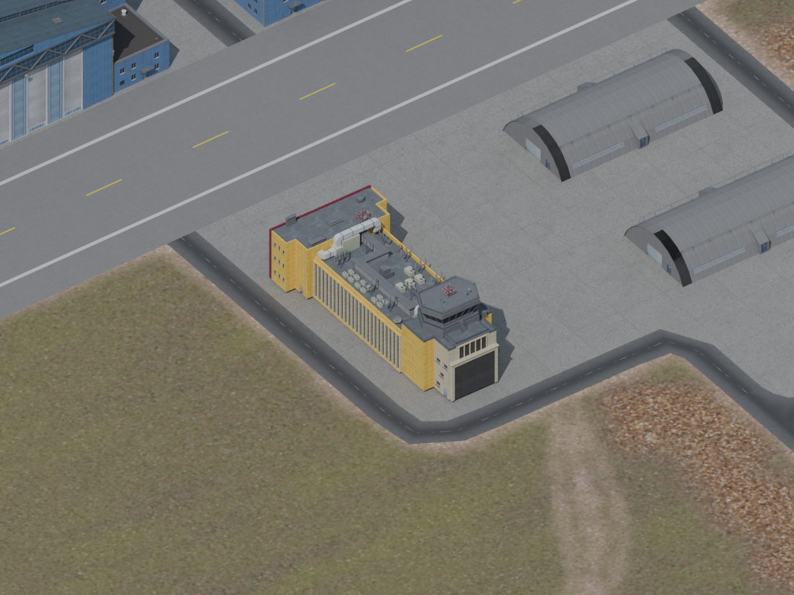
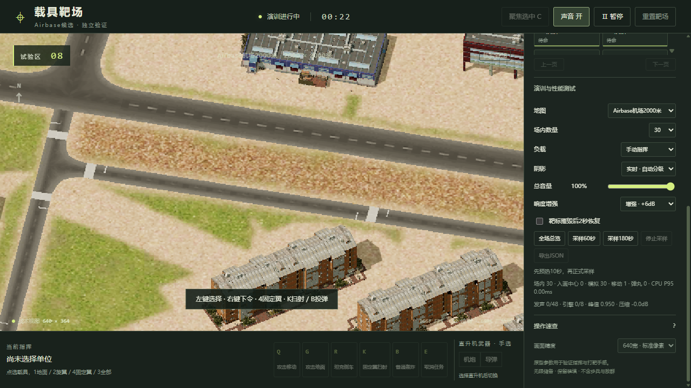
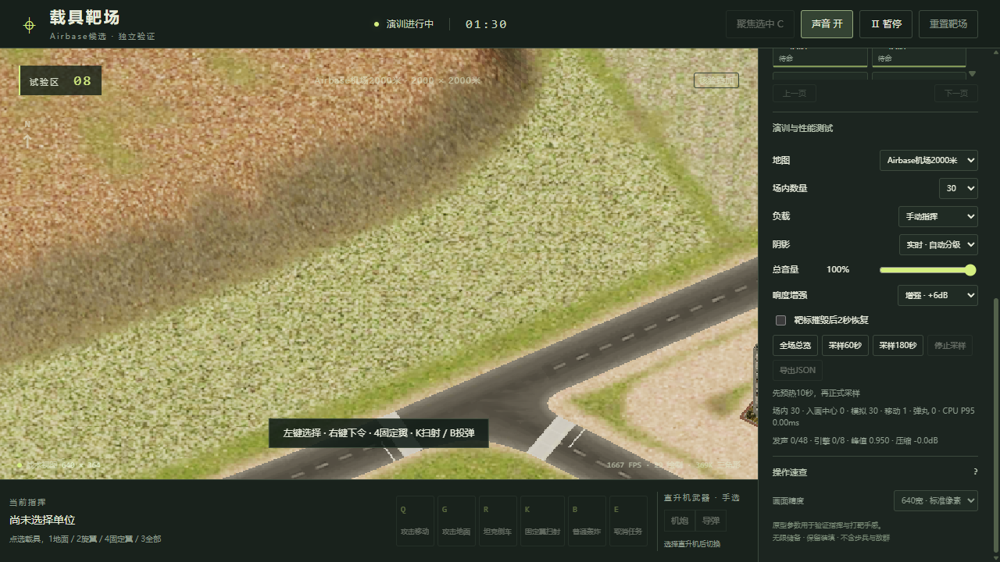
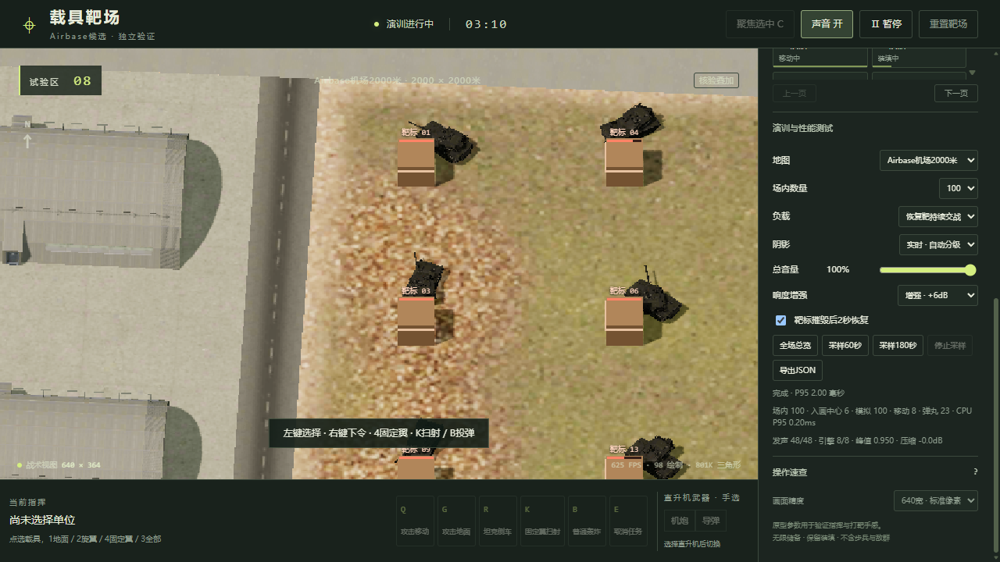

# 机场地图提取与验证报告

## 当前结果与入口

500×500米首测通过G0、G1、G2后，在独立批次扩展至2000×2000米并通过G3。两阶段工程和凭证分别保存，源安装目录只读。未启动原游戏、未发布正式资源库或修改既有服务。

- 2公里预览：<http://127.0.0.1:8781/>；500米冻结预览：<http://127.0.0.1:8780/>。
- 本地交付位置：`local-data/断箭/批次/BA-26273833-011/交付/2000米/r02/`。其中`Airbase-2000米.blend`为可编辑工程，`Airbase-2000米.glb`为完整交换模型，`README.md`为本地文件导航，`阶段通过-2000米.json`为G3凭证。大文件不随正式报告发布。
- [来源说明](../../research/断箭/机场地图说明.md)、[核验摘要](../../research/断箭/机场地图核验摘要.json)、[脚本入口](../../scripts/断箭/地图提取说明.md)。

点击“全场总览”看完整区域；WASD平移、滚轮缩放、F复位，声音需点击解锁。服务仅本机回环可用。

## 提取范围与来源

| 项目 | 500米首测 | 2公里扩展 |
| --- | --- | --- |
| 批次与工程版本 | 010／r03 | 011／r02 |
| 尺寸 | 500×500米 | 2000×2000米 |
| 静态实例／原型 | 10／5 | 162／34 |
| 高度采样 | 501×501，零洞 | 2001×2001，零洞 |
| GLB独立100点最大高度误差 | 0.003272米 | 0.005734米 |
| 冻结源码 | s04 | s05 |
| 运行组织 | 独立GLB | 运行优化/r03，256个125米块 |

162是源静态实例数，包含6架固定布景运输机及成对机库部件，不等于162栋独立建筑。14个跨边界实例保留完整形体。全场242个网格对象、3,639,259个三角形；主工程贴图打包并重开，完整GLB由独立进程导入回读。

源构建26273833、UnityFS头6000.3.24f1。BuildSettings[7]关联Airbase，实际节点level7／sharedassets7.assets；建筑按ResourceManager、SceneCompressorBank十浮点TRS和Addressables精确原型恢复。道路为源网格及标线，地形以实际显示的高细节网格为准。

共用源原点(4425,136,4850)，转换为(x−4425,y−136,4850−z)，无缩放和复制铺图。扩展源X为3425至5425、Z为3850至5850。162项矩阵独立比对最大误差约2.97×10⁻⁸；两地标源／输出距离均2739.552755米，距离误差0，实例负行列式0。

## 分块、通行与交互

256块采用实际三角形裁切和UV插值；23,265组同源接缝最大高差0.000032891米。最多49块驻留，超限回收几何和材质，局部未齐备时显示完整低精度总览。建筑原型按125米位置实例化，跨块物体只绘制一次；高度和碰撞不随渲染卸载。

共享图像在下载、转码及GPU层复用。运行媒体全集82.50 MiB，首屏仅取必要部分，不等于首次传输。291份GLB逐属性和有向三角形回读一致，Meshopt没有减面或量化浮点属性；KTX2底色有损，实际看图另验。258像素图向上采样为512解决本机压缩纹理黑块，保留UV和内容，不增加源细节。

11组通行通过：10组到达或按规则裁剪到安全目标，1组角落高台按坡度规则阻挡。不可达建筑中心投影到可走位置，边界命令受控裁剪。长路线实际约2443米，建筑侵入及贴地高度超差0。原高台输入保留，1米细化确认在当前30度坡度及5.8米规划余量下与主区不通。动态车体余量5.3米，未模拟悬挂或炮管精确扫掠。

真实点选、右键、暂停恢复、停止、倒车、聚焦、滚轮、地面拾取、旧地图平地回归、5次切换重置和声音解码通过。双浏览器附加坡面夹具核对实际炮口与模拟坐标，最大差0.00003206米；弹道与地表高度最大差0.00000163米。车辆高程一致；夹具不代替真实键鼠证据。

源谷仓原型含一处镜像子节点，运行时将其变换烘焙到克隆几何并校正三角形绕序，保留作者位置。两浏览器核对实际静态实例矩阵负行列式为零，并查看谷仓近景；完整源工程与GLB保持不变。

## 双浏览器性能

硬件为Ryzen 7 9800X3D、Radeon RX 7900 XTX，驱动32.0.31041.1004。Chrome和Edge独立可见窗口串行，视口1280×720、内部640×364、DPR1，当前统一库256规格、声音开启、100%音量与6dB增强、实时阴影自动分级。解除垂直同步和帧率上限，记录整帧，不以CPU耗时替代。

每档预热10秒；空场60秒、10辆M1A2移动60秒、80坦克／16旋翼／4固定翼连续移动交战180秒。固定58米局部镜头，100在场模拟，非100全部同屏。

| 浏览器 | 100负载P95毫秒 | P99毫秒 | 最长帧毫秒 | 冷可操作秒 | 首次地图MiB | 绘制峰值 | 三角形峰值 |
| --- | --- | --- | --- | --- | --- | --- | --- |
| chrome 156.0.8078.80 | 2.00 | 3.50 | 8.70 | 1.08 | 61.65 | 147 | 1,041,706 |
| msedge 156.0.4314.58 | 2.00 | 3.70 | 7.90 | 1.03 | 61.65 | 147 | 1,041,794 |

| 浏览器 | 空场P95毫秒 | 10车P95毫秒 | 100负载P95毫秒 | 跨区秒 | 地表射线 | 回收次数 |
| --- | --- | --- | --- | --- | --- | --- |
| chrome | 0.60 | 0.90 | 2.00 | 90.13 | 2200 | 163 |
| msedge | 0.60 | 0.90 | 2.00 | 90.94 | 2225 | 166 |

两浏览器P95、首传80 MiB／15秒、局部350绘制／200万三角形及512 MiB纹理估算均通过。默认30单位出生间距24米，初始局部约161.7万提交；原12米密集出生约248万的对照记录保留。总览约490万提交量另记，不套用局部预算。

90秒闭合跨区逐秒25点射线均有实际可见地表支撑，最多49驻留块，回收和回访正常，关键图实际查看，无黑块与可见空洞。100负载采样时间线为6至8单位入画，实际移动4至52个，事件声最多48路、引擎8路。纹理估算峰值105.15 MiB，非驱动显存实测。完整长帧、堆、寻路、可见／移动／发声和源码指纹在本地JSON。

500米冻结首测双浏览器100负载P95均1.80毫秒、首传29.06 MiB。首测凭证SHA256：`472d8745565bde7563501cb26a9d52363afc1d24243eeb6d0d25232d02c9c0ea`。2公里G3凭证SHA256：`d47c3eb09f47e3fd14ab71627277b0ceb5f1b905eae2b988b72bf8de2a80830a`。

## 限制与恢复

- 源数据重建，无原游戏截图对照；真实图层底色、权重、UV及参数派生，未复刻全部Shader高度混合、微纹理、天气与破损。2公里4096底色的近景单位面积精度低于首测，未平铺伪造细节。
- 原Navigation ng未直接转换，Demo导航为派生；不含建筑进入／破坏、车辆悬挂、联机或飞机起降。固定翼使用安全高度和外侧缓冲。
- 性能限本机、已测编队和镜头，不承诺其他电脑、手机、公网冷启动或任意100同屏密集视野。
- 失败工程、假射线命中、相机远裁剪、黑块、首帧计时及优化前编队记录保留；未删除旧模型音效、其他任务或首测。
- 批次执行状态为恢复入口，采样每15秒保存进度，未完整结束不能判通过。服务按端口、PID和身份管理；新快照不覆盖旧快照或继承旧验收。

运行契约见[地图模块](../../src/地图验证/README.md)，授权边界见[实施计划](../../docs/地图与载具/机场地图提取首测与扩展-实施计划.md)。未迁入public/assets，未Git提交或发布。
