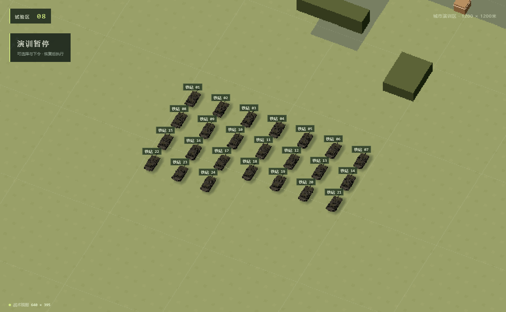
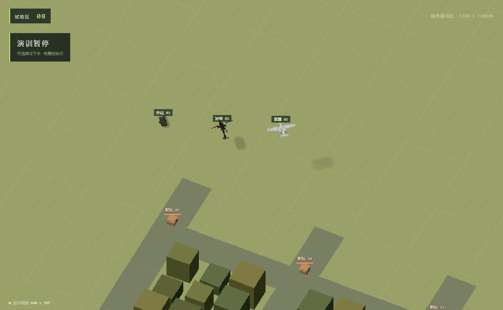
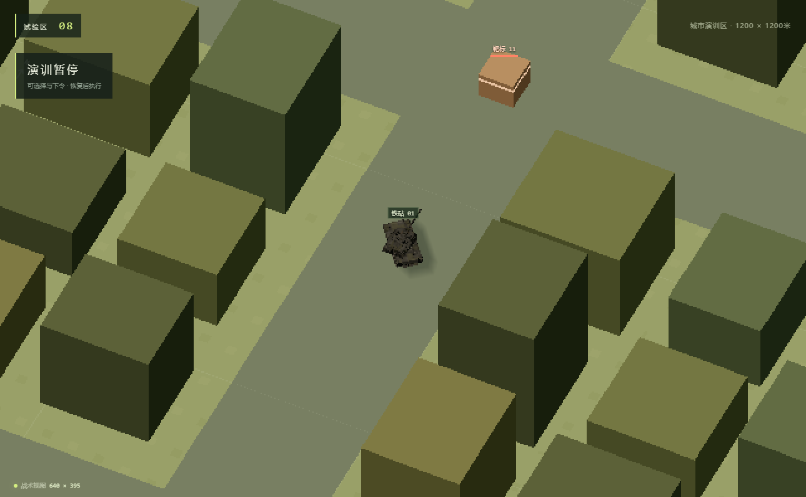

# 载具阴影优化验证

## 范围与实现

固定白天，保留像素风，改善车底压地感与轻微方向感；首轮允许建筑遮光简化。每单位仍为一份假阴影、每型号一个实例批；顶点透明度提供中央深、边缘淡的轮廓，朝向跟随车身。固定太阳产生高度投影，空中载具随各自高度淡化。主要模型材质已有AO与法线信息，本轮不重复烘焙，只校准原有两盏灯。

单份阴影由26顶点改为17顶点，保持24三角形，改用单面透明材质。新增每实例4字节透明度，仅高度改变时上传；按型号独立几何使资源对象数量略增，连续重置会释放旧几何。没有增加贴图、实时阴影贴图或后期通道。

## 视觉对照

同样的30单位静态布局、跨度120与镜头角度；数字截图不替代工程师观感验收。

### 改前

### 改后

### 空中高度与道路

空地图使用测试姿态便于观察不同车型，实际巡航高度沿用游戏配置。阴影平面0.065米，高于道路0.045米。选择、旋转、缩放、真实右键移动后阴影跟随与连续四次重置均通过两浏览器检查；0、90度及斜向的车身轴对照通过。

## 性能

本机RX 7900 XTX，独立无窗口Chrome／Edge，视口1600×1000，三维640×395，全场总览。总音量100%、增强6dB，有声交战；每组预热10秒、正式60秒，浏览器测试串行。改前只拦截冻结的场景源码，其他源码及同一份运行资源清单一致；本阶段使用当前压缩运行资源，不能直接与旧资产阶段容量比较。

GPU耗时来自EXT_disjoint_timer_query_webgl2，每8帧异步抽样；CPU列仅包裹渲染提交，不代表模拟或页面全部CPU。显示帧时间可能受约144Hz刷新节奏限制。

| 浏览器 | 单位 | 轮次 | 版本 | 帧P95毫秒 | 帧P99毫秒 | 最长帧毫秒 | GPU P95毫秒 | 提交CPU P95毫秒 | 超33.34毫秒帧数 |
| --- | ---: | --- | --- | ---: | ---: | ---: | ---: | ---: | ---: |
| chrome | 100 | 首测 | 改前 | 7.20 | 7.30 | 14.00 | 4.172 | 0.60 | 0 |
| chrome | 100 | 首测 | 改后 | 7.20 | 7.40 | 13.90 | 3.981 | 0.50 | 0 |
| chrome | 500 | 首测 | 改前 | 7.20 | 7.40 | 14.10 | 4.326 | 0.50 | 0 |
| chrome | 500 | 首测 | 改后 | 7.20 | 7.30 | 14.10 | 6.176 | 0.50 | 0 |
| chrome | 500 | 反序复测 | 改后 | 7.20 | 7.40 | 14.30 | 4.157 | 0.50 | 0 |
| chrome | 500 | 反序复测 | 改前 | 7.20 | 7.40 | 14.00 | 4.842 | 0.60 | 0 |
| msedge | 100 | 首测 | 改前 | 7.20 | 7.40 | 14.10 | 2.718 | 0.70 | 0 |
| msedge | 100 | 首测 | 改后 | 7.20 | 7.30 | 14.30 | 4.327 | 0.60 | 0 |
| msedge | 500 | 首测 | 改前 | 7.20 | 7.30 | 14.10 | 4.633 | 0.60 | 0 |
| msedge | 500 | 首测 | 改后 | 7.20 | 7.30 | 14.10 | 5.581 | 0.50 | 0 |

同一固定静态画面：绘制46→43，提交三角形1,654,450→1,653,730，纹理52→52，几何资源对象41→43。交战中靶标恢复和弹丸使瞬时绘制数变化，性能表不拿单个时刻的绘制数冒充完整段平均值。

整段GPU分位在浏览器与轮次间存在明显波动，首测Chrome500单位和Edge部分样本的改后值较高，因此保留首测并追加反序复测及同上下文隔离。判断应同时查看各轮、完整帧时间与GPU结果，不以相同FPS宣称GPU成本为零。摘要见[验证数据](阴影优化验证摘要.json)。500单位仍为探索，不承诺长期最大容量或其他设备性能。

### 同一冻结场景的GPU隔离

在同一浏览器、同一WebGL上下文和同一冻结交战姿态下，仅交错替换三批阴影的几何、材质、矩阵及原有两盏灯参数。先预热两侧，再执行16轮改前／改后／改后／改前，每侧32份查询，每份包含4次渲染，表内是平均单次渲染毫秒。此项用于定位渲染成本，不代表实际交战帧率，计时波动仍需保留。

| 浏览器 | 单位 | 改前中位毫秒 | 改后中位毫秒 | 改前P95毫秒 | 改后P95毫秒 |
| --- | ---: | ---: | ---: | ---: | ---: |
| chrome | 100 | 0.768 | 0.763 | 0.780 | 0.784 |
| chrome | 500 | 2.161 | 2.101 | 3.136 | 3.623 |
| msedge | 100 | 0.771 | 0.772 | 0.784 | 0.783 |
| msedge | 500 | 2.176 | 2.151 | 2.468 | 3.308 |

100单位主验与500单位探索的正式样本均达到当前本机60FPS帧预算。阴影绘制与提交量下降，同场景典型GPU时间作为辅助对照；不将尾部分位波动解释成已经证明所有时刻零成本。

## 服务与证据

验证中发现旧服务读取共享导出清单，其他端口覆盖或清理该文件会令媒体路由与清单不一致。现改为每服务内存冻结清单。独立HTTP故障注入将清单文件映射到不存在的路径，GET／HEAD仍200、长度一致，三型模型HEAD均200；没有删除实际共享文件。当前验证使用系统分配端口，未终止旧8768服务；Python修复对新进程生效。

原始回执、冻结源码、运行清单摘要、故障注入与排障记录在忽略的`local-data/原型/载具靶场/验证/阴影优化1/`。错误加载和中止样本不计入上表。模型与声音原件未改写，正式研究资料不作为运行依赖。

## 限制与复用

当前是假阴影：平地接收、车型近似轮廓，未实现建筑挡光、墙面／屋顶接收、斜坡贴合或真实自阴影。坦克炮管与飞机侧倾不参与真实轮廓投射。视觉最终由工程师试玩确认。

- [靶场模块](../../src/载具靶场/README.md)
- [实施计划](../../docs/靶场阴影优化-实施计划.md)
- [Three.js官方阴影说明](https://threejs.org/manual/pages/shadows.html)
