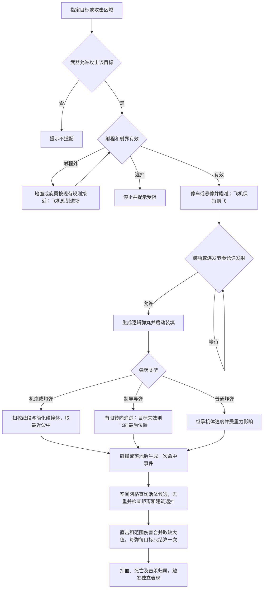

# 三车参数对照与对丧尸设计建议

版本：V001。工程师已确认载具打丧尸、普通丧尸100生命、不强制爆头、保护基地或防线；载具受损后续讨论。

## 证据与单位

原值来自构建26273833历史数据库和固定配装，不代表当前安装最新版本。源字段原样保留，运行换算和枚举尚未核验。当前值来自实际靶场源码；建议值是独立设计初值，未接入或试玩。

## 三车原始移动参数

| 载具 | 单位ID | 机动ID | 道路速度原值 | 越野原值 | 倒车原值 | 转率原值 | 加速度原值 | 飞行预设ID |
| --- | --- | --- | --- | --- | --- | --- | --- | --- |
| M1A2 | 245 | 1 | 70.0 | 55.0 | 35.0 | 60.0 | 10.0 | 0 |
| AH-64D | 19 | 7 | 265.0 | 265.0 | 0.0 | 60.0 | 16.0 | 0 |
| A-10C | 282 | 131 | 450.0 | 0.0 | 0.0 | 100.0 | 0.0 | 8 |

固定翼Mobility中的0不代表飞机不能加速，应继续读取PlaneFlyPresets；原始JSON包含完整关联。

## 固定配装与弹药原值

| 载具 | 武器ID／弹药ID | 弹药名称 | 地面／低空／高空射程原值 | 伤害原值 | 伤害半径原值 | 数量关系原值 |
| --- | --- | --- | --- | --- | --- | --- |
| M1A2 | 18／19 | Bullet 12.7x99 | 400.0／0.0／0.0 | 1.0 | 0.0 | 200 |
| M1A2 | 27／27 | Bullet 7.62x51 MG | 300.0／0.0／0.0 | 0.75 | 0.0 | 1140 |
| M1A2 | 342／256 | Round 120 M256 AP M1A2 T2.5 | 650.0／0.0／0.0 | 10.0 | 0.0 | 16 |
| M1A2 | 342／253 | Round 120 M256 HEAT M1A2 T2.5 | 650.0／0.0／0.0 | 11.0 | 9.0 | 24 |
| AH-64D | 8／10 | Round 30 M230 HEDP Heli T3 | 500.0／500.0／0.0 | 2.25 | 3.0 | 120 |
| AH-64D | 12／164 | Missile AT Hellfire | 950.0／0.0／0.0 | 15.0 | 0.0 | 4 |
| AH-64D | 15／17 | Rocket 70 Hydra Pod | 600.0／0.0／0.0 | 3.5 | 14.0 | 19 |
| AH-64D | 545／17 | Rocket 70 Hydra Pod | 600.0／0.0／0.0 | 3.5 | 14.0 | 19 |
| A-10C | 373／287 | Bomb 907kg Mk84 | 1000.0／0.0／0.0 | 56.0 | 75.0 | 1 |
| A-10C | 378／59 | Missile A2A AIM9 Plane | 0.0／1000.0／1000.0 | 13.0 | 15.0 | 2 |
| A-10C | 383／293 | Round 30 GAU8 A10C Mixed | 1000.0／700.0／500.0 | 2.25 | 17.0 | 235 |
| A-10C | 387／147 | Missile AGM AGM65H Plane | 1250.0／0.0／0.0 | 22.0 | 10.0 | 3 |

数量是WeaponAmmunitions关系行值，不是整机总量；例如多个相同挂架不可不经调用核对直接相加或相乘。完整炮塔槽、武器、弹药及选项见原始JSON。

## 网页建议值与当前值

| 武器 | 当前射程／间隔／伤害／半径 | 建议射程／间隔／伤害／外半径 | 对丧尸职责 |
| --- | --- | --- | --- |
| M1A2主炮范围弹 | 52米／3.2秒／180／4米 | 90米／3.2秒／180／7米 | 对密集地面群体形成间歇清场，副机枪作为后续持续补漏候选 |
| AH-64D机炮 | 43米／0.3秒／22／1米 | 100米／0.15秒／24／2米 | 持续点杀与小范围清群，避免无限无停顿射击 |
| AH-64D导弹 | 74米／6秒／290／5米 | 160米／6秒／290／5米 | 保留移动目标追踪验证；普通尸群不自动优先消耗导弹 |
| A-10C机炮扫射 | 240米／0.1秒／28／1.8米 | 240米／0.1秒／28／1.8米 | 沿玩家拖线进行单次扫射，伤害由实际命中和落点决定 |
| A-10C普通炸弹 | 320米／6秒／680／17米 | 320米／6秒／400／22米 | 预判尸群位置的单次区域清场；投放后不追踪目标 |

所有建议伤害均采用普通丧尸100生命的独立量表，不能用原作Damage倍率换算。机炮间隔是逻辑弹间隔；连发组和组间休息另列于建议JSON。炸弹射程只作任务引导参考，是否投放仍由高度、速度、弹道与预计落点决定。

## 弹药判定流程图

下图为本项目建议，不是已还原的原作调用图。原作已确认的表字段与原生方法签名分别归档；没有推断其精确调用次序。

## 三类武器的简化规则

1. 机炮／直射炮弹使用前后位置扫掠，避免高速穿过小目标。丧尸用低成本胶囊或圆柱，不逐骨骼三角形碰撞；首轮不穿透多只、不强制爆头。
2. 爆炸按三维距离衰减，实心建筑挡住爆炸到目标中心的射线则本次范围伤害为0；边缘阈值与内部满伤半径显式配置。伤害查询不依赖特效显示上限。
3. 保留现有发射后自主追踪作为项目规则。原AH-64D弹药164为LaserGuided=true，未证明发射后不管；转换为本项目规则必须明确记录。目标死亡不自动换活靶，继续飞向最后有效位置再落地或寿命结束。
4. Mk84普通炸弹离机后不追踪丧尸群；以预测落点覆盖区域。固定翼单轮攻击后脱离并盘旋，不自动连续轰炸。
5. 不把原作StressDamage直接改名为丧尸恐惧。击退、减速、压制、断肢、尸体物理和履带碾压均后置。

## 爆炸计算建议

`d = length(目标受击中心 - 爆心)`；`d <= r0`为满伤，`r0 < d <= R`线性降至`edge × D`，`d > R`为0。边界R包含，刚超过R即为0。直击与范围伤害取较大值，不重复相加。

`falloff(d) = 1`（内圈）；`1 - (1-edge) × (d-r0)/(R-r0)`（衰减圈）。最终伤害先检查阵营、活体和遮挡，再计算`D × falloff`。所有参数属于本项目建议。

## 测试与后续决策

优先测单只100生命、密集群、稀疏群、隔墙、半径边缘、高速移动目标、导弹目标提前死亡、取消命令后的在途弹、双弹同帧死亡。不同数量下分别记录模拟CPU、查询次数、逻辑弹数、死亡队列、尸体／特效数和整帧P95，不能套用独立群体测试的帧率。

基地压力作为失败来源；防线生命、丧尸接触伤害、波次密度与目标优先级还需后续定案。先保留无限储备与装填，后续用弹药成本、补给、出动间隔和待命区约束空中优势；本轮不擅自加入有限弹药。

## 文件与来源

[原始参数](三车原始参数.json)、[当前靶场参数](当前靶场参数.json)、[建议参数](网页原型建议参数.json)。

[官方手册](https://ftp.matrixgames.com/pub/BrokenArrow/BrokenArrowManualEBOOK.pdf)用于核对射界、装填以外的操作约束及固定翼攻击方式；[官方入门指南](https://brokenarrow_backend.slitherine.com/news/broken-arrows-survival-guide)区分发现目标和捕获目标。文档为相应公开版本，不代替当前构建实操。

## 验证与保留

生成器核对所有原始引用、当前源码及建议公式；页面检查另有本地回执。设计和听感、战斗性能、平衡验收仍待实施后验证。本轮首次交付，无被替代载荷和退役清单；原数据库和原生方法索引作为研究依赖保留。
